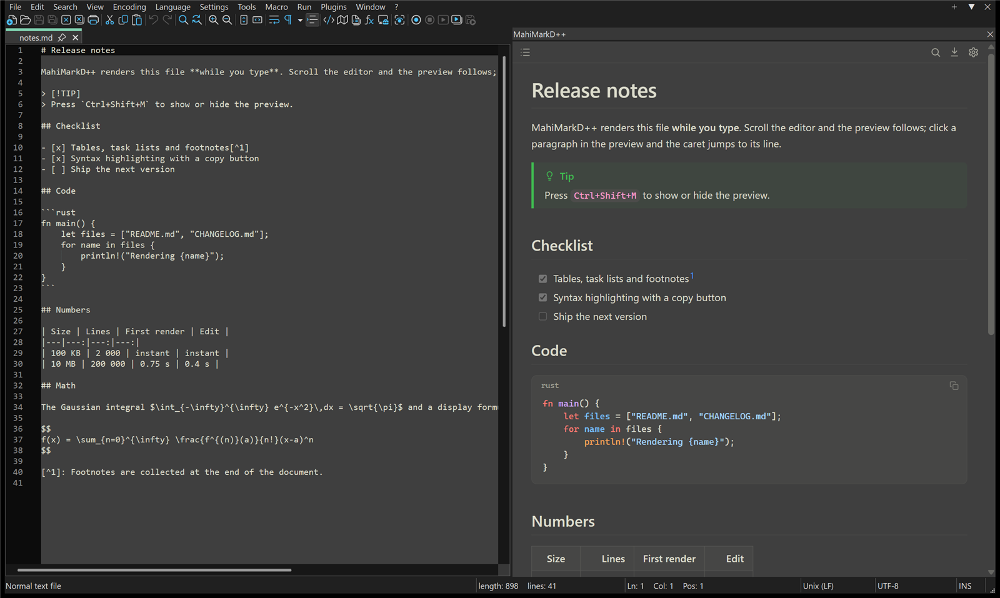

<div align="center">

# MahiMarkD++

**Fast, lightweight Markdown preview for Notepad++, written in Rust**
<br>
**Быстрый и лёгкий предпросмотр Markdown для Notepad++, написанный на Rust**

[](https://github.com/Mahiron-hq/MahiMarkD-PlusPlus/releases/latest)
[](LICENSE)
[](#)
[](https://notepad-plus-plus.org/)
[](#)
[](https://www.rust-lang.org/)

**[English](#english)** · **[Русский](#русский)**

</div>

| | |
|---|---|
| Platform | Windows 10/11, Notepad++ 8.4.1+ (x64, x86, ARM64) |
| License | GPL-3.0 |
| Download | [Releases](https://github.com/Mahiron-hq/MahiMarkD-PlusPlus/releases/latest) |
| Languages | English, Russian |

---

## English

MahiMarkD++ shows the rendered document in a panel next to the editor and keeps it in sync while you type and scroll. It is native code written in Rust and ships as a single DLL with everything inside.


### Why MahiMarkD++

- **Native and lightweight.** Written in Rust: native speed and memory safety with no garbage collector. One 3 MB DLL holds the renderer, highlight.js, KaTeX and fonts. It needs no .NET, Java, Python or Visual C++ runtime, and no installer.
- **The editor never waits.** Markdown is parsed on a background thread, and only the blocks you changed are updated on the page. A 10 MB file of 200,000 lines first renders in about 0.75 s, and edits show up in about 0.4 s.
- **Modern rendering.** The preview uses Microsoft Edge WebView2 (Chromium), so tables, fonts, emoji and high-DPI screens look the same as in a current browser.
- **Private and offline.** No telemetry and no online services. The only network requests are images your document links to.
- **Safe with untrusted files.** Raw HTML is sanitized, scripts from the document never run, and the page can load only the plugin's own files.
- **Export without extra tools.** HTML, PDF and Word (DOCX) are built in. You don't need Pandoc, Word or a separate browser.

### Features

#### Markdown

- GitHub Flavored Markdown: tables, task lists, strikethrough, footnotes, alerts (`> [!NOTE]`), YAML front matter, heading anchors.
- Syntax highlighting for code blocks with a copy button.
- Math with KaTeX: `$inline$`, `$$display$$` and ```` ```math ```` blocks.
- Local images and relative links. Links to other files open in Notepad++, and web links open in the browser.


#### Navigation

- Two-way scroll sync with the editor. Click in the preview to move the caret to that line.
- Table of contents sidebar that follows the scroll position.
- Find in preview (Ctrl+F, F3, Shift+F3) and zoom (Ctrl+wheel, Ctrl+Plus, Ctrl+Minus, Ctrl+0).
- Opens automatically for Markdown files (configurable).

#### Themes and export

- Light and dark themes. The Auto theme follows the colors of the Notepad++ editor theme.
- Export to a single self-contained HTML file with highlighting and math, to PDF (A4 or Letter) and to Word (DOCX).



### Requirements

- Windows 10 or 11 (x64, x86 or ARM64)
- Notepad++ 8.4.1 or newer (tested with 8.9.8 and 8.9.9)
- Microsoft Edge WebView2 Runtime

#### Installing WebView2

WebView2 is already part of Windows 11 and up-to-date Windows 10. To check, look for **Microsoft Edge WebView2 Runtime** in Settings → Apps → Installed apps. If it is missing, the panel shows a message with a download link.

1. Download the installer from Microsoft: [MicrosoftEdgeWebview2Setup.exe](https://go.microsoft.com/fwlink/p/?LinkId=2124703) (from the [WebView2 page](https://developer.microsoft.com/microsoft-edge/webview2/), "Evergreen Bootstrapper").
2. Run it. It downloads and installs the runtime, and Windows keeps it up to date.
3. Reopen the preview panel or restart Notepad++.

Or run `winget install Microsoft.EdgeWebView2Runtime` in a terminal.

### Installation

1. Download `MahiMarkD-PlusPlus-<version>-<arch>.zip` for your Notepad++ build (x64, x86 or arm64) from [Releases](https://github.com/Mahiron-hq/MahiMarkD-PlusPlus/releases/latest).
2. Close Notepad++.
3. Extract the archive into `<Notepad++ folder>\plugins\MahiMarkD++\` so that the file is `plugins\MahiMarkD++\MahiMarkD++.dll`.
4. Start Notepad++ and open a `.md` file.

Notepad++ opens new side panels narrow. Drag the panel border to the width you like once, and Notepad++ remembers it.

### Usage

| Action | How |
|---|---|
| Show or hide the preview | Plugins → MahiMarkD++ → Markdown Preview, or Ctrl+Shift+M |
| Export | Toolbar button in the panel, or Plugins → MahiMarkD++ → Export to … |
| Settings | Gear button in the panel, or Plugins → MahiMarkD++ → Settings |
| Back to the editor | Esc in the preview |

The shortcut can be changed in Settings → Shortcut Mapper → Plugin commands.

### Settings

Settings are stored in `MahiMarkD++.json` in the Notepad++ plugin config folder (usually `%APPDATA%\Notepad++\plugins\config`). They can be changed from the settings page in the panel:

- theme (Auto, Light, Dark), font size, text and code fonts, content width;
- automatic opening and the list of Markdown file extensions;
- scroll sync, click-to-source, math, update delay while typing;
- PDF page size (A4 or Letter).

The WebView2 cache is kept in `%LOCALAPPDATA%\MahiMarkD++\WebView2`.

### Building

Requires Rust 1.95+ with the MSVC toolchain and the Visual Studio Build Tools (C++ x64/x86 and ARM64 components for all targets).

```powershell
cargo test
cargo build --release
.\scripts\package.ps1
```

`package.ps1` builds x64, x86 and ARM64, puts the archives into `dist\` and writes `SHA256SUMS.txt`.

### License

Copyright (C) 2026 Lev Burmistrov (Mahiron-hq).

MahiMarkD++ is free software under the [GNU General Public License v3.0](LICENSE). Third-party components and their licenses are listed in [THIRD-PARTY-NOTICES.md](THIRD-PARTY-NOTICES.md).

---

## Русский

MahiMarkD++ показывает готовый документ в панели рядом с редактором и обновляет её, пока вы печатаете и прокручиваете текст. Это нативный код на Rust: плагин поставляется одной DLL, в которой уже есть всё нужное.


### Почему MahiMarkD++

- **Нативный и лёгкий.** Написан на Rust: скорость нативного кода и безопасная работа с памятью без сборщика мусора. Одна DLL на 3 МБ содержит рендерер, highlight.js, KaTeX и шрифты. Не нужны .NET, Java, Python, Visual C++ Redistributable и установщик.
- **Редактор никогда не ждёт.** Разбор Markdown идёт в фоновом потоке, а на странице обновляются только изменённые блоки. Файл на 10 МБ и 200 000 строк открывается примерно за 0,75 с, правки появляются примерно за 0,4 с.
- **Современная отрисовка.** Превью работает на Microsoft Edge WebView2 (Chromium), поэтому таблицы, шрифты, эмодзи и экраны с высоким DPI выглядят как в современном браузере.
- **Приватно и без интернета.** Никакой телеметрии и онлайн-сервисов. В сеть уходят только запросы картинок, на которые ссылается сам документ.
- **Безопасен для чужих файлов.** HTML внутри Markdown очищается, скрипты из документа не выполняются, а страница может загружать только файлы самого плагина.
- **Экспорт без сторонних программ.** HTML, PDF и Word (DOCX) встроены. Не нужны Pandoc, Word или отдельный браузер.

### Возможности

#### Markdown

- GitHub Flavored Markdown: таблицы, списки задач, зачёркивание, сноски, блоки `> [!NOTE]`, YAML front matter, якоря заголовков.
- Подсветка синтаксиса в блоках кода и кнопка копирования.
- Формулы KaTeX: `$строчные$`, `$$выносные$$` и блоки ```` ```math ````.
- Локальные картинки и относительные ссылки. Ссылки на другие файлы открываются в Notepad++, веб-ссылки в браузере.


#### Навигация

- Синхронная прокрутка в обе стороны. Клик в превью ставит курсор редактора на эту строку.
- Боковое оглавление, которое следит за прокруткой.
- Поиск в превью (Ctrl+F, F3, Shift+F3) и масштаб (Ctrl+колесо, Ctrl+Плюс, Ctrl+Минус, Ctrl+0).
- Автоматически открывается для Markdown-файлов (настраивается).

#### Темы и экспорт

- Светлая и тёмная темы. Тема Auto берёт цвета текущей темы редактора Notepad++.
- Экспорт в один самодостаточный HTML-файл с подсветкой и формулами, в PDF (A4 или Letter) и в Word (DOCX).


### Требования

- Windows 10 или 11 (x64, x86 или ARM64)
- Notepad++ 8.4.1 или новее (проверено на 8.9.8 и 8.9.9)
- Microsoft Edge WebView2 Runtime

#### Установка WebView2

WebView2 уже входит в Windows 11 и обновлённую Windows 10. Проверить можно в Параметры → Приложения → Установленные приложения: там должен быть **Microsoft Edge WebView2 Runtime**. Если его нет, панель покажет сообщение со ссылкой на загрузку.

1. Скачайте установщик с сайта Microsoft: [MicrosoftEdgeWebview2Setup.exe](https://go.microsoft.com/fwlink/p/?LinkId=2124703) (со [страницы WebView2](https://developer.microsoft.com/microsoft-edge/webview2/), пункт «Evergreen Bootstrapper»).
2. Запустите его. Он скачает и установит среду, а дальше Windows будет обновлять её сама.
3. Откройте панель превью заново или перезапустите Notepad++.

Или выполните в терминале `winget install Microsoft.EdgeWebView2Runtime`.

### Установка

1. Скачайте `MahiMarkD-PlusPlus-<версия>-<arch>.zip` под вашу сборку Notepad++ (x64, x86 или arm64) из [релизов](https://github.com/Mahiron-hq/MahiMarkD-PlusPlus/releases/latest).
2. Закройте Notepad++.
3. Распакуйте архив в `<папка Notepad++>\plugins\MahiMarkD++\`, чтобы получился файл `plugins\MahiMarkD++\MahiMarkD++.dll`.
4. Запустите Notepad++ и откройте `.md`-файл.

Новые боковые панели Notepad++ открывает узкими. Один раз растяните панель за край до удобной ширины, и Notepad++ её запомнит.

### Использование

| Действие | Как |
|---|---|
| Показать или скрыть превью | Plugins → MahiMarkD++ → Markdown Preview или Ctrl+Shift+M |
| Экспорт | Кнопка на панели или Plugins → MahiMarkD++ → Export to … |
| Настройки | Шестерёнка на панели или Plugins → MahiMarkD++ → Settings |
| Вернуться в редактор | Esc в превью |

Горячую клавишу можно сменить в Settings → Shortcut Mapper → Plugin commands.

### Настройки

Настройки хранятся в `MahiMarkD++.json` в папке настроек плагинов Notepad++ (обычно `%APPDATA%\Notepad++\plugins\config`). Их можно менять на странице настроек в панели:

- тема (Auto, Light, Dark), размер шрифта, шрифты текста и кода, ширина содержимого;
- автоматическое открытие и список расширений Markdown-файлов;
- синхронная прокрутка, переход к строке по клику, формулы, задержка обновления при наборе;
- размер страницы PDF (A4 или Letter).

Кэш WebView2 хранится в `%LOCALAPPDATA%\MahiMarkD++\WebView2`.

### Сборка

Нужны Rust 1.95+ с MSVC и Visual Studio Build Tools (компоненты C++ x64/x86 и ARM64 для всех целей).

```powershell
cargo test
cargo build --release
.\scripts\package.ps1
```

`package.ps1` собирает x64, x86 и ARM64, кладёт архивы в `dist\` и записывает `SHA256SUMS.txt`.

### Лицензия

Copyright (C) 2026 Lev Burmistrov (Mahiron-hq).

MahiMarkD++ - свободная программа под лицензией [GNU General Public License v3.0](LICENSE). Сторонние компоненты и их лицензии перечислены в [THIRD-PARTY-NOTICES.md](THIRD-PARTY-NOTICES.md).
