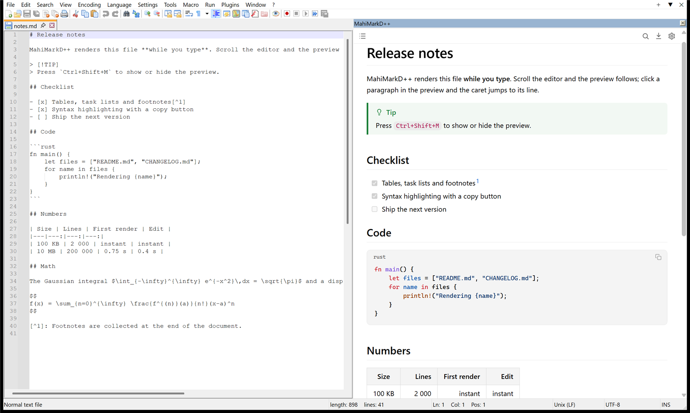
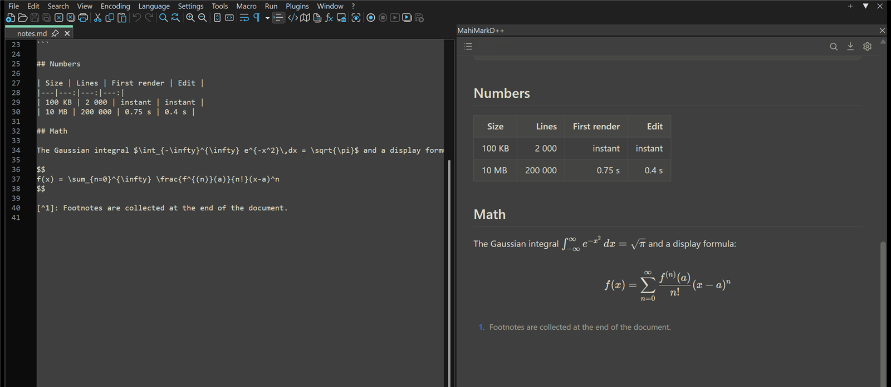

<div align="center">

# MahiMarkD++

**Fast Markdown preview for Notepad++ that stays smooth on large files**
<br>
**Быстрый предпросмотр Markdown для Notepad++, который не тормозит на больших файлах**

[](https://github.com/Mahiron-hq/MahiMarkD-PlusPlus/releases/latest)
[](LICENSE)
[](#)
[](https://notepad-plus-plus.org/)
[](#)
[](https://www.rust-lang.org/)

**[English](#-english)** · **[Русский](#-русский)**

</div>

---

## 🇬🇧 English

MahiMarkD++ renders the current document in a dockable panel next to the editor and keeps it in sync while you type and scroll. Rendering runs on a background thread and only changed blocks are updated, so even a 10 MB file stays responsive.



### Features

- GitHub Flavored Markdown: tables, task lists, strikethrough, footnotes, alerts (`> [!NOTE]`), YAML front matter, heading anchors.
- Syntax highlighting for code blocks (highlight.js) with a copy button.
- Math with KaTeX: `$inline$`, `$$display$$` and ```` ```math ```` blocks.
- Two-way scroll sync with the editor; click in the preview to move the caret to that line.
- Table of contents sidebar that follows the scroll position.
- Find in preview (Ctrl+F, F3, Shift+F3), zoom (Ctrl+wheel, Ctrl+Plus, Ctrl+Minus, Ctrl+0).
- Local images and relative links; links to other files open in Notepad++, web links open in the browser.
- Raw HTML is allowed but sanitized: scripts, event handlers and unsafe URLs are removed.
- Light and dark themes; the Auto theme follows the colors of the Notepad++ editor theme.
- Export to HTML (self-contained, with highlighting and math), PDF and Word (DOCX).
- Opens automatically for Markdown files (configurable).
- Built for large documents: incremental updates, lazy highlighting and math rendering, off-screen content is not laid out.


### Requirements

- Windows 10 or 11 (x64, x86 or ARM64)
- Notepad++ 8.4.1 or newer (tested with 8.9.8 and 8.9.9)
- Microsoft Edge WebView2 Runtime (preinstalled on Windows 11 and on up-to-date Windows 10)

### Installation

1. Download `MahiMarkD-PlusPlus-<version>-<arch>.zip` for your Notepad++ build (x64, x86 or arm64) from [Releases](https://github.com/Mahiron-hq/MahiMarkD-PlusPlus/releases/latest).
2. Close Notepad++.
3. Extract the archive into `<Notepad++ folder>\plugins\MahiMarkD++\` so that the file is `plugins\MahiMarkD++\MahiMarkD++.dll`.
4. Start Notepad++ and open a `.md` file.

Notepad++ opens new side panels narrow. Drag the panel border to the width you like once, and Notepad++ remembers it.

### Usage

| Action | How |
|---|---|
| Show or hide the preview | Plugins → MahiMarkD++ → Markdown Preview, or Ctrl+Shift+M |
| Export | Toolbar button in the panel, or Plugins → MahiMarkD++ → Export to … |
| Settings | Gear button in the panel, or Plugins → MahiMarkD++ → Settings |
| Back to the editor | Esc in the preview |

The shortcut can be changed in Settings → Shortcut Mapper → Plugin commands.



### Settings

Settings are stored in `MahiMarkD++.json` in the Notepad++ plugin config folder (usually `%APPDATA%\Notepad++\plugins\config`). They can be changed from the settings page in the panel:

- theme (Auto, Light, Dark), font size, text and code fonts, content width;
- automatic opening and the list of Markdown file extensions;
- scroll sync, click-to-source, math, update delay while typing;
- PDF page size (A4 or Letter).

The WebView2 cache is kept in `%LOCALAPPDATA%\MahiMarkD++\WebView2`.

### Building

Requires Rust 1.95+ with the MSVC toolchain and the Visual Studio Build Tools (C++ x64/x86 and ARM64 components for all targets).

```powershell
cargo test
cargo build --release
.\scripts\package.ps1
```

`package.ps1` builds x64, x86 and ARM64, puts the archives into `dist\` and writes `SHA256SUMS.txt`.

### License

Copyright (C) 2026 Lev Burmistrov (Mahiron-hq).

MahiMarkD++ is free software under the [GNU General Public License v3.0](LICENSE). Third-party components and their licenses are listed in [THIRD-PARTY-NOTICES.md](THIRD-PARTY-NOTICES.md).

---

## 🇷🇺 Русский

MahiMarkD++ показывает текущий документ в панели рядом с редактором и обновляет её, пока вы печатаете и прокручиваете текст. Разбор идёт в фоновом потоке, а на странице меняются только изменённые блоки, поэтому даже файл на 10 МБ не тормозит.


### Возможности

- GitHub Flavored Markdown: таблицы, списки задач, зачёркивание, сноски, блоки `> [!NOTE]`, YAML front matter, якоря заголовков.
- Подсветка синтаксиса в блоках кода (highlight.js) и кнопка копирования.
- Формулы KaTeX: `$строчные$`, `$$выносные$$` и блоки ```` ```math ````.
- Синхронная прокрутка в обе стороны; клик в превью ставит курсор редактора на эту строку.
- Боковое оглавление, которое следит за прокруткой.
- Поиск в превью (Ctrl+F, F3, Shift+F3), масштаб (Ctrl+колесо, Ctrl+Плюс, Ctrl+Минус, Ctrl+0).
- Локальные картинки и относительные ссылки; ссылки на другие файлы открываются в Notepad++, веб-ссылки в браузере.
- HTML внутри Markdown разрешён, но очищается: скрипты, обработчики событий и опасные ссылки удаляются.
- Светлая и тёмная темы; тема Auto берёт цвета текущей темы редактора Notepad++.
- Экспорт в HTML (один файл с подсветкой и формулами), PDF и Word (DOCX).
- Автоматически открывается для Markdown-файлов (настраивается).
- Рассчитан на большие документы: обновляются только изменения, подсветка и формулы считаются по мере прокрутки, невидимая часть не отрисовывается.


### Требования

- Windows 10 или 11 (x64, x86 или ARM64)
- Notepad++ 8.4.1 или новее (проверено на 8.9.8 и 8.9.9)
- Microsoft Edge WebView2 Runtime (уже есть в Windows 11 и в обновлённой Windows 10)

### Установка

1. Скачайте `MahiMarkD-PlusPlus-<версия>-<arch>.zip` под вашу сборку Notepad++ (x64, x86 или arm64) из [релизов](https://github.com/Mahiron-hq/MahiMarkD-PlusPlus/releases/latest).
2. Закройте Notepad++.
3. Распакуйте архив в `<папка Notepad++>\plugins\MahiMarkD++\`, чтобы получился файл `plugins\MahiMarkD++\MahiMarkD++.dll`.
4. Запустите Notepad++ и откройте `.md`-файл.

Новые боковые панели Notepad++ открывает узкими. Один раз растяните панель за край до удобной ширины, и Notepad++ её запомнит.

### Использование

| Действие | Как |
|---|---|
| Показать или скрыть превью | Plugins → MahiMarkD++ → Markdown Preview или Ctrl+Shift+M |
| Экспорт | Кнопка на панели или Plugins → MahiMarkD++ → Export to … |
| Настройки | Шестерёнка на панели или Plugins → MahiMarkD++ → Settings |
| Вернуться в редактор | Esc в превью |

Горячую клавишу можно сменить в Settings → Shortcut Mapper → Plugin commands.


### Настройки

Настройки хранятся в `MahiMarkD++.json` в папке настроек плагинов Notepad++ (обычно `%APPDATA%\Notepad++\plugins\config`). Их можно менять на странице настроек в панели:

- тема (Auto, Light, Dark), размер шрифта, шрифты текста и кода, ширина содержимого;
- автоматическое открытие и список расширений Markdown-файлов;
- синхронная прокрутка, переход к строке по клику, формулы, задержка обновления при наборе;
- размер страницы PDF (A4 или Letter).

Кэш WebView2 хранится в `%LOCALAPPDATA%\MahiMarkD++\WebView2`.

### Сборка

Нужны Rust 1.95+ с MSVC и Visual Studio Build Tools (компоненты C++ x64/x86 и ARM64 для всех целей).

```powershell
cargo test
cargo build --release
.\scripts\package.ps1
```

`package.ps1` собирает x64, x86 и ARM64, кладёт архивы в `dist\` и записывает `SHA256SUMS.txt`.

### Лицензия

Copyright (C) 2026 Lev Burmistrov (Mahiron-hq).

MahiMarkD++ — свободная программа под лицензией [GNU General Public License v3.0](LICENSE). Сторонние компоненты и их лицензии перечислены в [THIRD-PARTY-NOTICES.md](THIRD-PARTY-NOTICES.md).
